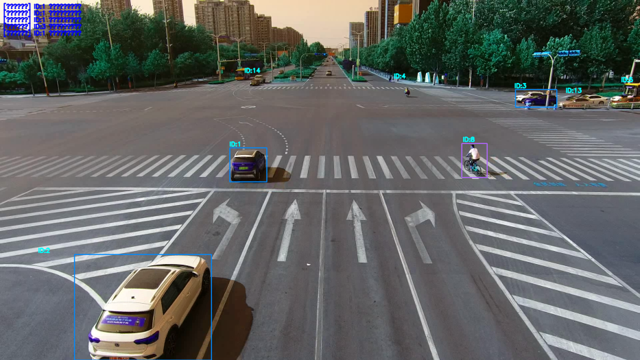
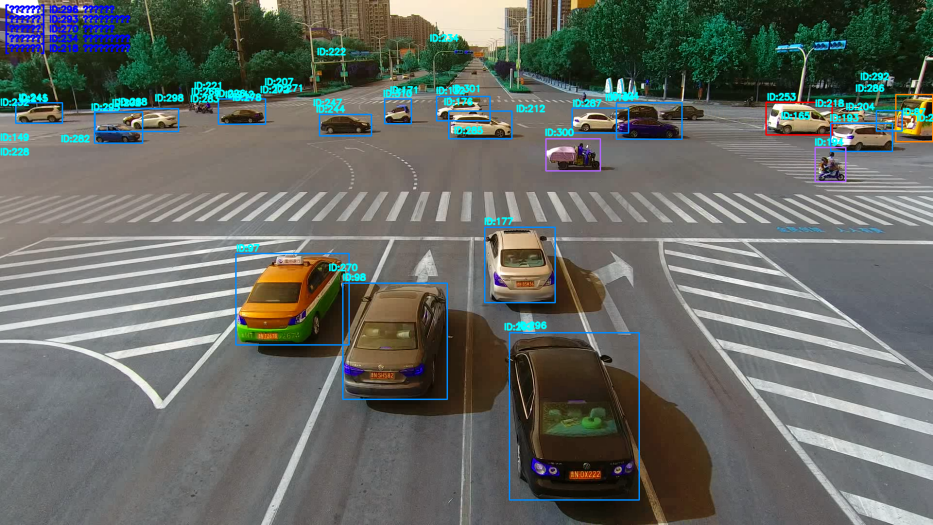
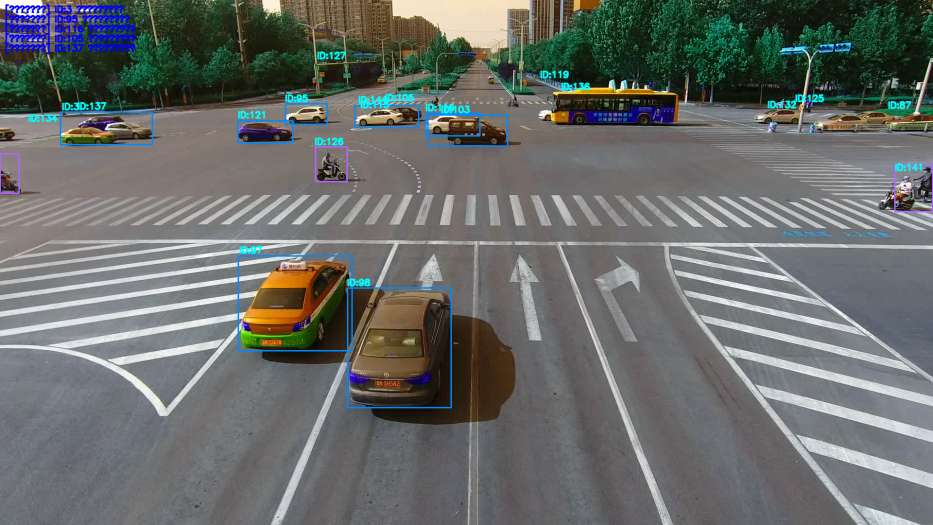
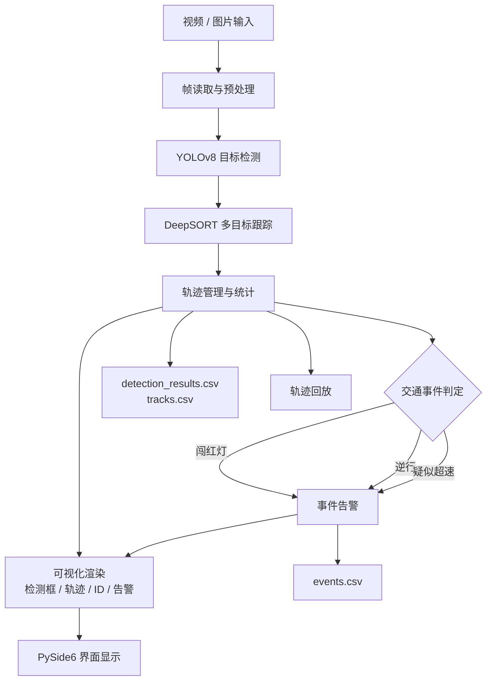
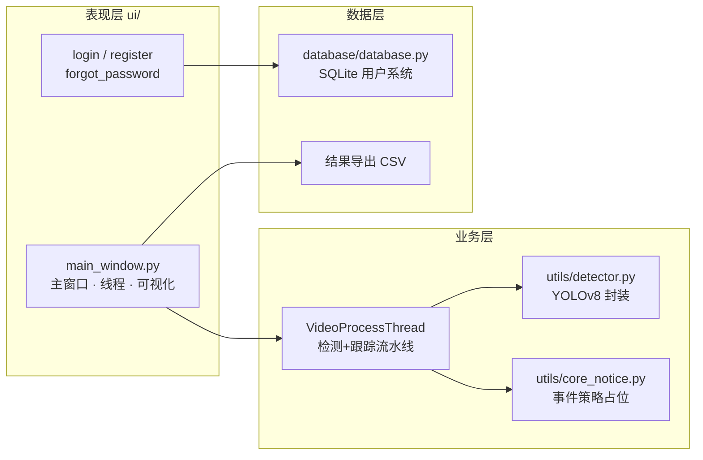

# 智能交通监控系统 · YOLOv8 + DeepSORT

> 基于 **YOLOv8** 目标检测与 **DeepSORT** 多目标跟踪的桌面端交通监控系统。
> 面向路口高位监控场景，实现车辆 / 行人 / 两轮车的实时检测与稳定跟踪，
> 并在此基础上完成交通事件告警、轨迹分析与结果导出。


---

## 一、项目简介

城市路口的交通监控长期依赖人工盯屏，存在效率低、易漏检、难以形成结构化数据的问题。
本项目实现了一套**端到端的桌面端智能交通监控系统**：从视频/图片输入出发，完成
目标检测 → 多目标跟踪 → 交通事件判定 → 可视化呈现 → 结构化数据导出 的完整链路。

项目特点：

- **完整工程闭环**：不是单个算法脚本，而是一套可直接运行的桌面应用——包含用户系统、
  参数交互、实时可视化、轨迹回放与结果导出。
- **不依赖专用硬件**：仅用普通摄像头画面即可完成检测与事件告警，便于落地。
- **工程与算法分离**：核心事件判定策略被隔离为独立模块（见
  [「关于核心算法」](#七关于核心算法未开源说明)），保证工程代码可读、可测、可替换。
- **可分析的结果输出**：检测、事件、轨迹三类结果均导出为 CSV，可直接用于统计分析。

> 本项目为本科毕业设计课题的工程实现部分。

## 二、效果展示

路口高位视角下的实时检测与跟踪结果（不同颜色代表不同目标类别，`ID:x` 为跟踪 ID）：



多目标密集场景下的检测与跟踪稳定性：



车辆、两轮车、公交车的混合场景：



## 三、功能特性

| 模块 | 能力 | 说明 |
| --- | --- | --- |
| 用户系统 | 注册 / 登录 / 找回密码 | SQLite 本地存储，支持头像与密保问题 |
| 目标检测 | YOLOv8 推理 | 支持 6 类目标：小汽车、面包车、公交车、卡车、行人、两轮车 |
| 多目标跟踪 | DeepSORT | 为每个目标分配稳定 `track_id`，缓解遮挡导致的 ID 切换 |
| 轨迹管理 | 轨迹记录与可视化 | 轨迹点数上限保护、按类别着色、支持轨迹显示开关 |
| 轨迹回放 | 单目标 / 多目标回放 | 点击轨迹表即可跳转到该目标出现的时间点回放 |
| 交通事件 | 闯红灯 / 逆行 / 疑似超速 | 支持停止线标记、车道区域划分、信号灯状态与车道方向设置 |
| 交互参数 | 置信度 / IOU / 播放速度 | 滑动条实时调节，0.5x ~ 5x 变速播放 |
| 结果导出 | 检测 / 事件 / 轨迹 CSV | 支持「保存检测结果」与「另存为」两种导出方式 |
| 批量处理 | 图片列表批量检测 | 支持上一张 / 下一张导航浏览 |
| 健壮性 | 依赖缺失降级 | 模型或依赖不可用时回退到提示窗口，不静默崩溃 |

## 四、系统架构

整体数据流：



代码分层：



详细的模块职责、线程模型与设计取舍见 [`docs/ARCHITECTURE.md`](docs/ARCHITECTURE.md)。

## 五、技术栈

| 层面 | 选型 | 版本 |
| --- | --- | --- |
| 语言 | Python | 3.9+ |
| 目标检测 | Ultralytics YOLOv8 | 最新版 |
| 多目标跟踪 | deep-sort-realtime | 最新版 |
| 桌面 GUI | PySide6 (Qt for Python) | 6.6.2 |
| 图像处理 | OpenCV | 4.6.0 |
| 数值计算 | NumPy | 1.24 |
| 用户数据 | SQLite (标准库 `sqlite3`) | — |

## 六、快速开始

### 1. 准备环境

```bash
git clone https://github.com/gugu734551/traffic-monitoring-system.git
cd traffic-monitoring-system

python -m venv .venv
.venv\Scripts\activate          # Windows
pip install -r requirements.txt
```

### 2. 准备模型权重

仓库不包含训练权重（体积原因）。请将 Ultralytics 训练导出的 `best.pt`
放到 `model/` 目录下，然后在界面中点击 **选择模型文件** 加载它。

> 若没有自训练权重，也可以用官方 `yolov8n.pt` 先跑通流程。

### 3. 启动

```bash
python main.py
```

启动后：注册并登录 → 选择模型文件 → 选择图片 / 视频 → 观察检测、跟踪与事件告警。

## 七、关于核心算法（未开源说明）

本仓库公开的是系统的**完整工程实现**：界面、检测封装、跟踪流水线、轨迹管理、
参数交互、结果导出与用户系统，均可在阅读后直接运行。

而课题的**核心策略**——交通事件（闯红灯 / 逆行 / 疑似超速）的判定规则、
阈值整定与上报去重时机——属于论文核心内容，**未随本仓库开源**。

具体处理方式：

- 相关方法的**位置、签名、文档与调用关系全部保留**，工程链路完整可读可运行；
- 方法体内改为调用 `utils/core_notice.py` 中的占位函数，返回安全默认值
  （判定类返回 `False`，事件列表返回 `[]`），首次调用时给出明确提示；
- 策略所需的**数据结构与事件字典字段契约**保留不变，因此界面事件表与
  `events.csv` 导出格式不受影响；
- 核心策略的完整设计可以在面试中当面讲解与推演。

这样做的好处是：仓库既能让面试官看清我的工程能力与系统设计，又不会提前公开
论文尚未发表的核心内容。**请勿将本仓库的占位实现误认为完整算法。**

## 八、结果输出说明

点击 **保存检测结果** 后，会在 `results/<时间戳>/` 下生成：

| 文件 | 内容 | 字段 |
| --- | --- | --- |
| `detection_results.csv` | 逐目标检测结果 | 序号、轨迹ID、画面标识、结果、位置、置信度 |
| `events.csv` | 交通事件告警 | type、frame、time_s、track_id、cls、vnorm、v_px_s、point_x、point_y |
| `tracks.csv` | 轨迹级统计 | track_id、cls、count、avg_vnorm、max_vnorm、avg_v_px_s、max_v_px_s、speeding |

`assets/samples/` 下提供了三个文件的真实导出样例（已截断为前若干行）。

## 九、实验结果

在 KITTI 数据集上评估，并与同类算法对比（数据来自论文实验章节）：

**目标检测精度**

| 算法 | 车辆 | 行人 | 非机动车 | 平均检测时间 |
| --- | --- | --- | --- | --- |
| YOLOv5 | 89.5% | 84.2% | 81.7% | 20 ms |
| YOLOv7 | 91.5% | 86.3% | 84.2% | 16 ms |
| **YOLOv8** | **92.3%** | **87.5%** | **85.2%** | **15 ms** |

**多目标跟踪精度**

| 算法 | 车辆 | 行人 | 非机动车 | ID 切换率 |
| --- | --- | --- | --- | --- |
| SORT | 82.3% | 76.5% | 73.2% | 12.5% |
| **DeepSORT** | **89.7%** | **84.3%** | **81.5%** | **5.2%** |
| ByteTrack | 90.2% | 85.1% | 82.3% | 4.8% |

**交通事件检测与系统性能**

| 指标 | 结果 |
| --- | --- |
| 闯红灯检测准确率 | 91.2% |
| 逆行检测准确率 | 88.7% |
| 事件检测延迟 | < 1 s |
| 处理速度 | 25 FPS |
| 内存占用 | ≈ 1.2 GB |
| CPU 占用 | ≈ 40% |

上述指标来自论文实验章节，`performance_output.py` 将其集中输出，便于核对：

```bash
python performance_output.py
```

## 十、项目结构

```text
traffic-monitoring-system/
├── main.py                     # 应用入口：登录/注册/主窗口的路由
├── requirements.txt
├── performance_output.py       # 论文结果数据汇总输出
├── ui/
│   ├── main_window.py          # 主窗口、视频处理线程、可视化与导出
│   ├── login.py                # 登录页
│   ├── register.py             # 注册页
│   └── forgot_password.py      # 找回密码
├── utils/
│   ├── detector.py             # YOLOv8 检测器封装（类别映射/颜色/过滤）
│   ├── common.py               # 图像格式转换等公共工具
│   └── core_notice.py          # 核心策略占位模块（见第七章）
├── database/
│   └── database.py             # SQLite 用户系统
├── model/                      # 放置自训练的 best.pt（不随仓库提供）
├── resources/
│   └── icons/                  # 界面图标资源
├── tools/
│   └── extract_frames.py       # 视频抽帧小工具
├── docs/
│   └── ARCHITECTURE.md         # 架构与设计说明
└── assets/
    ├── screenshots/            # 演示截图
    └── samples/                # 结果导出样例
```

## 十一、已知限制与改进方向

- 复杂场景（夜间、强逆光、密集遮挡）下检测精度仍有下降空间；
- 目标长时间互相遮挡时，跟踪仍可能出现少量 ID 切换；
- 事件判定目前基于单路口固定参数，尚未做到按场景自适应；
- 后续可引入更强的检测骨干、增加轨迹级后处理，或结合边缘设备做分布式部署。

## 十二、许可与声明

本项目源代码仅供学习与交流参考，**未经许可不得用于商业用途**，
详见 [`LICENSE`](LICENSE)。

仓库中不包含：论文正文、训练权重、原始测试视频、用户数据库。
